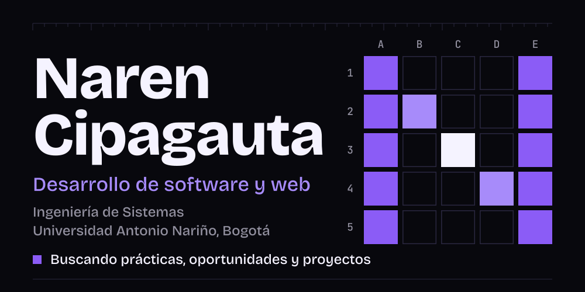
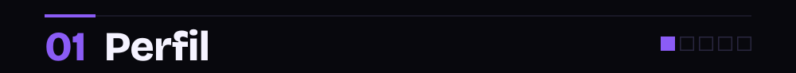
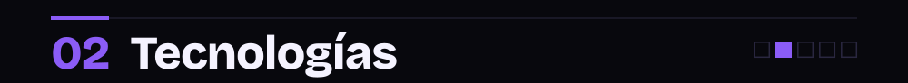
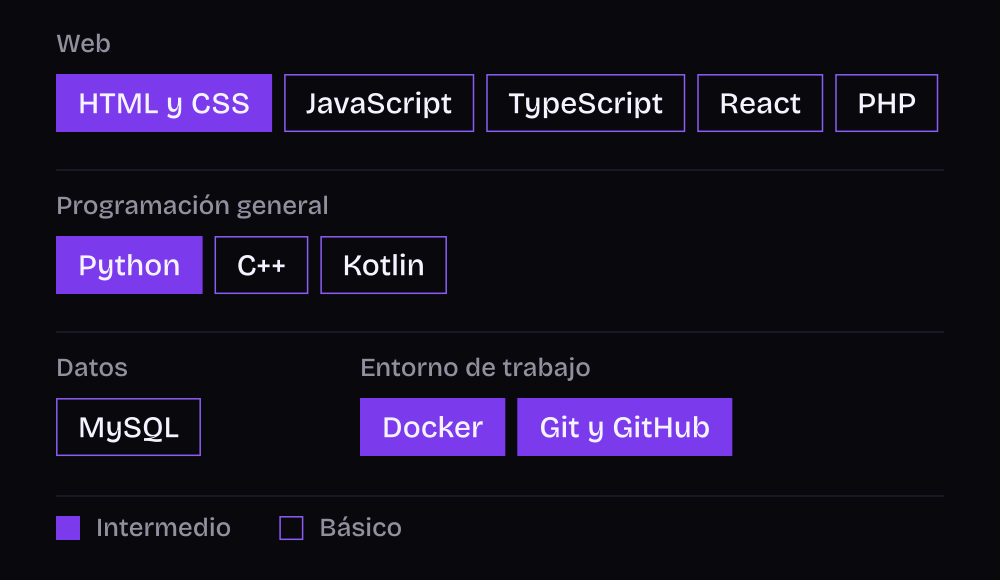
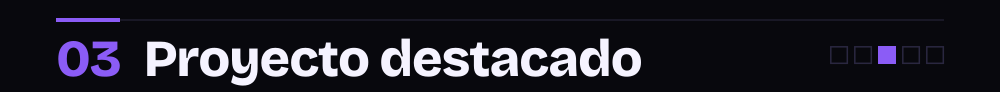
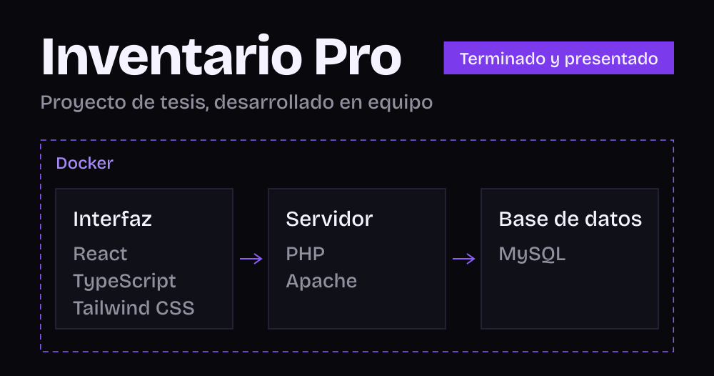
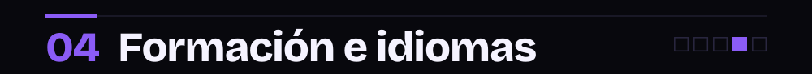

<!--
  README de perfil de NAREN2608.
  Recursos gráficos propios en /assets (SVG con el texto convertido a trazos: sin fuentes ni servicios externos).
  Para agregar otro proyecto: duplicar el bloque "Proyecto" de la sección 03 y añadir su ficha en /assets.
  Pendiente de confirmar nivel antes de listarlos en la sección 02: Java y SQL.
-->

  

<h2></h2>

Mi orientación es el desarrollo de software y el desarrollo web: backend, frontend, testing y aplicaciones.

**Enfoque.** Me gusta crear soluciones limpias y estructuradas.

**Problemas que me interesan.** Los que ordenan la información de un negocio: inventario, ventas, usuarios y permisos, como en Inventario Pro.

<h2></h2>

<h2></h2>

<!-- Proyecto -->

**Qué resuelve.** Reúne en un solo sistema la gestión del inventario y las ventas de un negocio, con acceso diferenciado por usuario y rol.

**Funcionalidades.** Gestión de inventario y productos, registro de ventas, y administración de usuarios y roles.

**Acceso.** El repositorio y la demostración son privados.
<!-- /Proyecto -->

<h2></h2>

**Formación.** Ingeniería de Sistemas, Universidad Antonio Nariño (Bogotá, Colombia). Último semestre.

**Idiomas.** Español: nativo. Inglés: B1/B2, sin certificación.

<h2></h2>

narenestivencipagauta13@gmail.com

  

