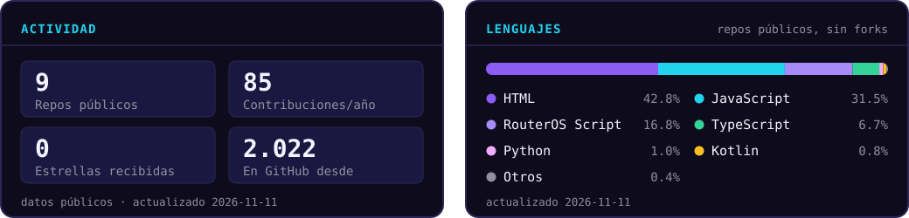

 

 

&nbsp;&nbsp;
&nbsp;&nbsp;

<h2></h2>

Soy **Naren**, estudiante de último semestre de Ingeniería de Sistemas en la Universidad Antonio Nariño (Bogotá, Colombia). Me oriento al desarrollo de software y web: backend, frontend, testing y aplicaciones.

- **Enfoque.** Me gusta crear soluciones limpias y estructuradas.
- **Problemas que me interesan.** Los que ordenan la información de un negocio: inventario, ventas, usuarios y permisos, como en Inventario Pro.
- **Ahora.** Terminando la carrera y buscando prácticas, oportunidades y proyectos.
- **Idiomas.** Español nativo; inglés B1/B2, sin certificación.

<h2></h2>

<h2></h2>

<!-- Proyecto: duplicar este bloque y su ficha en /assets para agregar otro -->

<!-- /Proyecto -->

<h2></h2>

<h2></h2>

Si quieres conversar sobre prácticas, oportunidades o proyectos, escríbeme a narenestivencipagauta13@gmail.com.

<!-- Pendiente de confirmar nivel antes de listarlos en el stack: Java y SQL. -->
